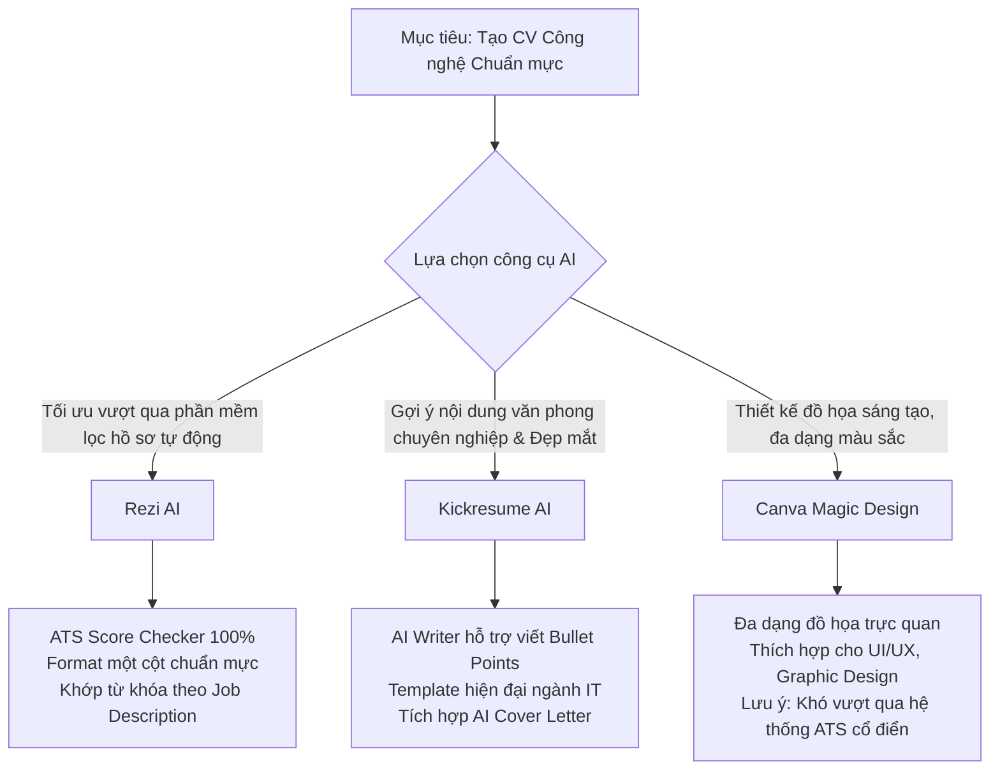

# BÁO CÁO ĐỒ ÁN MÔN HỌC
## ĐỀ TÀI: THIẾT KẾ CV SINH VIÊN TRONG LĨNH VỰC CÔNG NGHỆ THÔNG TIN & XÂY DỰNG WEB PORTFOLIO TRỰC TUYẾN TRÊN GITHUB PAGES

---

* **Học phần:** Phát triển Ứng dụng & Hướng nghiệp Công nghệ Thông tin
* **Sinh viên thực hiện:** Hồ Tiến Phát
* **Trường:** Đại học Công nghệ TP.HCM (HUTECH)
* **Chuyên ngành:** Công nghệ Thông tin / Kỹ thuật Phần mềm
* **Nền tảng triển khai Portfolio:** GitHub Pages (https://hotienphat.github.io/web/)

---

## MỤC LỤC TỔNG QUAN

1. [Phần 1: Giới thiệu Đề tài & Mục tiêu Dự án](#phan-1-gioi-thieu-de-tai--muc-tieu-du-an)
2. [Phần 2: Hướng nghiệp theo Lĩnh vực trong Ngành Công nghệ Thông tin](#phan-2-huong-nghiep-theo-linh-vuc-trong-nganh-cong-nghe-thong-tin)
   - 2.1. Lĩnh vực Lập trình Phát triển (Software / Web / Mobile Development)
   - 2.2. Lĩnh vực Dữ liệu (Data Science / Data Analytics / Data Engineering)
   - 2.3. Lĩnh vực Thiết kế Trải nghiệm Người dùng (UI/UX Design & Product Design)
   - 2.4. Lĩnh vực Vận hành & Hỗ trợ Kỹ thuật (IT Support / System Admin / Cloud DevOps)
   - 2.5. Bảng tổng hợp kỹ năng & tiêu chuẩn CV cho từng lĩnh vực
3. [Phần 3: Ứng dụng Công cụ AI trong Thiết kế CV Chuyên nghiệp](#phan-3-ung-dung-cong-cu-ai-trong-thiet-ke-cv-chuyen-nghiep)
   - 3.1. Phân tích & So sánh các công cụ AI tạo CV hàng đầu: Rezi, Kickresume, Canva AI
   - 3.2. Quy trình ứng dụng AI chuẩn hóa CV vượt qua bộ lọc ATS (Applicant Tracking System)
   - 3.3. Phương pháp Prompt Engineering chuẩn mực khi sinh nội dung CV
   - 3.4. Nguyên tắc kiểm soát và trách nhiệm: Tránh lạm dụng AI & Cá nhân hóa thành tựu cá nhân
4. [Phần 4: Xây dựng & Hiện thực hóa Web Portfolio trên GitHub Pages](#phan-4-xay-dung--hien-thuc-hoa-web-portfolio-tren-github-pages)
   - 4.1. Tại sao sinh viên công nghệ cần Portfolio trực tuyến song hành cùng CV?
   - 4.2. Kiến trúc Công nghệ & Mô hình Hệ thống của Website
   - 4.3. Giải trình kỹ thuật chi tiết từng phân hệ trên Website:
     * Module 1: Hero Section & Thẻ sinh viên tương tác vật lý (Lanyard Badge Physics)
     * Module 2: About Section & Vòng huy hiệu xoay SVG (Rotating SVG Text Badge)
     * Module 3: Bento Grid Digital Shortcuts Hub (Mạng xã hội, Tiện ích, Học tập)
     * Module 4: Work & Projects Showcase (Horizontal Interactive Accordion)
     * Module 5: Không gian 3D Tương tác 4 Mùa (Three.js WebGL 3D Bonsai Island)
     * Module 6: Trình phát nhạc nền & Viên thuốc Dynamic Island hiển thị Lời bài hát trực tiếp
     * Module 7: Hệ thống Chuyển đổi Giao diện Kép Sáng/Tối (Dark/Light Circular Ripple Transition)
     * Module 8: Cổng kết nối, Quyên góp & Sao chép Clipboard API
5. [Phần 5: Quy trình Đóng gói & Triển khai lên GitHub Pages](#phan-5-quy-trinh-dong-goi--trien-khai-len-github-pages)
   - 5.1. Cấu hình Git Repository và Branch
   - 5.2. Quản lý đường dẫn tài nguyên tĩnh tương đối (Relative Assets Paths)
   - 5.3. Tối ưu hóa hiệu năng tải trang và khả năng tương thích đa thiết bị
6. [Phần 6: Kịch bản Thuyết trình & Hướng dẫn Trả lời Phản biện (Defense Q&A Guide)](#phan-6-kich-ban-thuyet-trinh--huong-dan-tra-loi-phan-bien-defense-qa-guide)
   - 6.1. Khung dàn ý thuyết trình trước Giảng viên (Thời lượng 7 - 10 phút)
   - 6.2. Bộ câu hỏi phản biện trọng tâm và cách trả lời khẳng định quyền kiểm soát mã nguồn

---

## PHẦN 1: GIỚI THIỆU ĐỀ TÀI & MỤC TIÊU DỰ ÁN

Trong kỷ nguyên số hóa và thị trường tuyển dụng công nghệ có tính cạnh tranh ngày càng cao, hồ sơ năng lực của một sinh viên Công nghệ Thông tin (CNTT) không còn chỉ giới hạn ở một bản CV giấy truyền thống hay tệp PDF tĩnh 1 trang. Các doanh nghiệp công nghệ, đặc biệt là các công ty phần mềm, kỳ lân công nghệ và tập đoàn đa quốc gia, luôn tìm kiếm những ứng viên thể hiện được:
1. **Tư duy định hướng nghề nghiệp rõ ràng:** Biết mình muốn làm gì, thế mạnh ở mảng nào (Dev, Data, UI/UX hay System).
2. **Kỹ năng ứng dụng công nghệ mới:** Biết tận dụng sức mạnh của Trí tuệ Nhân tạo (AI) để tối ưu hóa quy trình làm việc, chuẩn bị hồ sơ khoa học, vượt qua các bộ lọc tự động (ATS) nhưng vẫn giữ được tính trung thực và cá nhân hóa sâu sắc.
3. **Năng lực thực chiến được minh chứng bằng sản phẩm thật:** Có sản phẩm trực tuyến để nhà tuyển dụng kiểm tra trực tiếp (Live Demo) thông qua nền tảng lưu trữ mã nguồn mở GitHub Pages.

**Mục tiêu trọng tâm của đồ án:**
* Nghiên cứu và phân tích các nhóm ngành nghề phổ biến trong lĩnh vực CNTT để xây dựng lộ trình CV phù hợp.
* Khảo sát, so sánh và thực hành các công cụ AI hỗ trợ tạo CV hàng đầu thế giới (Rezi, Kickresume, Canva AI).
* Thiết kế và lập trình hoàn chỉnh một trang web Portfolio cá nhân tương tác cao, kết hợp công nghệ đồ họa 3D WebGL (Three.js), hiệu ứng chuyển động GSAP, CSS Glassmorphism hiện đại, sau đó triển khai trực tiếp lên GitHub Pages.
* Xây dựng báo cáo khoa học, chứng minh tính tự chủ, tư duy lập trình logic và khả năng làm chủ toàn bộ mã nguồn của sinh viên.

---

## PHẦN 2: HƯỚNG NGHIỆP THEO LĨNH VỰC TRONG NGÀNH CÔNG NGHỆ THÔNG TIN

Để một bản CV gây ấn tượng mạnh với nhà tuyển dụng, sinh viên phải định vị chính xác vị trí công việc mục tiêu, từ đó lựa chọn từ khóa kỹ thuật (technical keywords), dự án tiêu biểu và các chứng chỉ phù hợp. Dưới đây là phân tích chi tiết 4 nhóm ngành chủ đạo:

### 2.1. Lĩnh vực Lập trình Phát triển (Software / Web / Mobile Development)
* **Đặc thù công việc:** Thiết kế, xây dựng, kiểm thử và tối ưu các ứng dụng phần mềm chạy trên nền tảng Web, Mobile hoặc Desktop.
* **Các nhánh chuyên sâu:**
  - *Frontend Developer:* Tập trung vào giao diện, trải nghiệm tương tác, tối ưu tốc độ render (HTML5, CSS3, JavaScript/TypeScript, React, Vue, Next.js, Tailwind CSS, Three.js, Canvas API).
  - *Backend Developer:* Xây dựng kiến trúc hệ thống, API, cơ sở dữ liệu và bảo mật (Node.js, Python/Django/FastAPI, Java Spring Boot, Golang, PostgreSQL, Redis, Docker).
  - *Mobile Developer:* Lập trình ứng dụng di động iOS/Android (Flutter, React Native, Swift, Kotlin).
* **Trọng tâm khi viết CV:**
  - Nhà tuyển dụng ngành Dev không đọc những lời giới thiệu sáo rỗng; họ nhìn trực tiếp vào **Tech Stack** và **Dự án thực tế (GitHub Link + Live Demo Link)**.
  - Sử dụng công thức viết đạn thành tựu (Bullet points) chuẩn **XYZ** của Google: *"Đã hoàn thành [X], đo lường bằng [Y], thông qua việc áp dụng công nghệ [Z]"*.

### 2.2. Lĩnh vực Dữ liệu (Data Science / Data Analytics / Data Engineering)
* **Đặc thù công việc:** Thu thập, làm sạch, mô hình hóa và khai thác giá trị kinh doanh từ dữ liệu lớn.
* **Các nhánh chuyên sâu:**
  - *Data Analyst (DA):* Trực quan hóa dữ liệu, phân tích xu hướng kinh doanh (SQL, Power BI, Tableau, Excel nâng cao, Python Pandas).
  - *Data Engineer (DE):* Thiết kế đường ống dẫn dữ liệu (ETL/ELT), tối ưu kho dữ liệu (SQL, Python, Apache Spark, Kafka, Airflow, Snowflake, AWS/GCP).
  - *Data Scientist / AI Engineer (DS/AI):* Huấn luyện mô hình máy học, phân tích dự báo (Machine Learning, Deep Learning, Scikit-learn, TensorFlow, PyTorch).
* **Trọng tâm khi viết CV:**
  - Tập trung vào các chỉ số kinh doanh định lượng: Tăng độ chính xác mô hình thêm bao nhiêu %, xử lý bao nhiêu Gigabyte/Terabyte dữ liệu mỗi ngày, giảm thời gian truy vấn dữ liệu bao nhiêu giây.

### 2.3. Lĩnh vực Thiết kế Trải nghiệm Người dùng (UI/UX Design & Product Design)
* **Đặc thù công việc:** Nghiên cứu hành vi người dùng (User Research), thiết kế kiến trúc thông tin (Information Architecture), tạo khung dây (Wireframe), nguyên mẫu tương tác (Interactive Prototype) và xây dựng Hệ thống Thiết kế (Design System).
* **Kỹ năng cốt lõi:** Figma, Adobe XD, Design Thinking, User Persona, Wireframing, Usability Testing, Typography, Color Psychology, Micro-interactions.
* **Trọng tâm khi viết CV:**
  - CV của UI/UX Designer bắt buộc phải có tính thẩm mỹ cao, căn lề chuẩn mực theo lưới (Grid System), độ tương phản màu sắc đạt chuẩn WCAG.
  - Phải có liên kết dẫn tới hồ sơ dự án chi tiết (Behance, Dribbble hoặc Web Portfolio cá nhân) mô tả rõ ràng quy trình nghiên cứu (Case Study) từ vấn đề (Problem) đến giải pháp (Solution).

### 2.4. Lĩnh vực Vận hành & Hỗ trợ Kỹ thuật (IT Support / System Admin / Cloud DevOps)
* **Đặc thù công việc:** Đảm bảo hệ thống mạng, hạ tầng máy chủ và ứng dụng hoạt động ổn định, bảo mật và liên tục (High Availability).
* **Kỹ năng cốt lõi:** Linux/Windows Server, Networking (TCP/IP, DNS, VPN), Docker, Kubernetes, CI/CD Pipeline (GitHub Actions, GitLab CI), AWS/Azure/GCP, Terraform, Monitoring (Prometheus, Grafana).
* **Trọng tâm khi viết CV:**
  - Nêu bật các chứng chỉ quốc tế giá trị: CCNA, CompTIA Security+, AWS Certified Solutions Architect, LPI Linux.
  - Nhấn mạnh vào tỉ lệ Uptime (99.9%), khả năng khắc phục sự cố (Troubleshooting), giảm thời gian gián đoạn hệ thống (Downtime).

### 2.5. Bảng tổng hợp đối sánh chiến lược CV theo từng lĩnh vực

| Lĩnh vực | Kỹ năng cốt lõi ưu tiên trong CV | Minh chứng bắt buộc phải đính kèm | Chỉ số đo lường hiệu quả (Metrics) |
| :--- | :--- | :--- | :--- |
| **Frontend Dev** | HTML5, CSS3, JS/TS, React, Three.js, Tailwind | Link GitHub Repository + Link Web Portfolio trực tuyến | Điểm Lighthouse (Performance 90+), tốc độ tải trang, số lượng components tái sử dụng |
| **Backend Dev** | Node.js, Python, Golang, SQL, Docker, Redis | Link mã nguồn GitHub, sơ đồ ERD, tài liệu Swagger/Postman | Tốc độ phản hồi API (ms), throughput (req/s), số lượng concurrent users chịu tải |
| **Data Analyst** | SQL, Python (Pandas/Numpy), Power BI, Statistics | Dashboard tương tác, phân tích bài toán thực tế trên Kaggle | Tỉ lệ lỗi dữ liệu giảm %, doanh thu/chi phí tối ưu nhờ insight |
| **UI/UX Design** | Figma, User Research, Wireframing, Prototype | Link Figma Showcase, Behance Portfolio, Case Studies | Tỉ lệ hoàn thành tác vụ (Task Success Rate), chỉ số SUS (System Usability Scale) |
| **IT Support/DevOps**| Linux, Shell Script, Docker, CI/CD, Networking | Kịch bản tự động hóa (Scripts), chứng chỉ quốc tế (AWS, Cisco) | Tỉ lệ Uptime hệ thống, thời gian MTTR (Mean Time to Recovery), tốc độ triển khai CI/CD |

---

## PHẦN 3: ỨNG DỤNG CÔNG CỤ AI TRONG THIẾT KẾ CV CHUYÊN NGHIỆP

### 3.1. Phân tích & So sánh các công cụ AI tạo CV hàng đầu

Để tìm ra giải pháp tối ưu cho sinh viên IT, đồ án đã tiến hành thử nghiệm và đối sánh 3 công cụ AI phổ biến nhất hiện nay: **Rezi**, **Kickresume** và **Canva AI**.



#### 1. Rezi (https://www.rezi.ai)
* **Thế mạnh vượt trội:** Rezi được mệnh danh là "ông vua" trong việc vượt qua hệ thống theo dõi ứng viên **ATS (Applicant Tracking System)**. Rezi sử dụng định dạng một cột sạch sẽ, mã hóa phông chữ chuẩn và cơ chế chấm điểm ATS Score theo thời gian thực.
* **Tính năng AI nổi bật:**
  - *AI Keyword Targeting:* Dán trực tiếp mô tả công việc (Job Description - JD) của doanh nghiệp tuyển dụng, AI của Rezi sẽ phân tích và chỉ ra các từ khóa kỹ thuật còn thiếu trong CV của sinh viên.
  - *AI Bullet Point Generator:* Tự động viết lại các câu mô tả kinh nghiệm theo cấu trúc động từ hành động mạnh mẽ (Action Verbs).
* **Đánh giá phù hợp:** Phù hợp nhất cho các vị trí Software Engineer, Backend, Data Engineer nộp hồ sơ vào các công ty công nghệ lớn, công ty nước ngoài yêu cầu scan hồ sơ tự động.

#### 2. Kickresume (https://www.kickresume.com)
* **Thế mạnh vượt trội:** Kickresume kết hợp hài hòa giữa tính thẩm mỹ hiện đại và tính chuẩn mực nội dung. Sử dụng mô hình OpenAI GPT chuyên sâu để soạn thảo văn phong hồ sơ xin việc chuẩn quốc tế.
* **Tính năng AI nổi bật:**
  - *Kickresume AI Writer:* Tự động gợi ý các đoạn tóm tắt sự nghiệp (Summary) và mô tả dự án theo từng vai trò cụ thể trong ngành IT.
  - *Resume to Web Portfolio:* Cho phép chuyển đổi nhanh nội dung CV thành một trang web đơn giản.
* **Đánh giá phù hợp:** Rất phù hợp cho sinh viên chuẩn bị tốt nghiệp cần một bản CV vừa mắt nhà tuyển dụng con người (Recruiter), bố cục cân đối và câu từ chỉn chu.

#### 3. Canva AI - Magic Design (https://www.canva.com)
* **Thế mạnh vượt trội:** Khả năng can thiệp đồ họa không giới hạn, hàng nghìn mẫu thiết kế sáng tạo, hỗ trợ xuất nhiều định dạng (PNG, PDF, Web Link).
* **Tính năng AI nổi bật:**
  - *Magic Write:* Hỗ trợ chỉnh sửa giọng văn, dịch thuật và mở rộng câu từ.
  - *Magic Design for Resumes:* Tự động áp dụng bảng màu và bố cục dựa trên phong cách mong muốn của người dùng.
* **Lưu ý quan trọng:** Canva tạo ra các tệp PDF dạng đồ họa vector hoặc phẳng. Nhiều hệ thống ATS cũ không thể quét và phân tách ký tự (parse text) được từ các bảng thiết kế nhiều cột phức tạp của Canva. Vì vậy, mẫu Canva chỉ nên dùng khi nộp trực tiếp qua email cho HR, nộp cho vị trí UI/UX/Designer hoặc in ra khi đi phỏng vấn trực tiếp.

### 3.2. Quy trình ứng dụng AI chuẩn hóa CV vượt qua bộ lọc ATS

```
Bước 1: Thu thập Mô tả Công việc (Job Description) từ nhà tuyển dụng
   ↓
Bước 2: Sử dụng AI để trích xuất Technical Keywords & Soft Skills cốt lõi
   ↓
Bước 3: Dự thảo kinh nghiệm, đồ án môn học cá nhân theo công thức STAR (Situation - Task - Action - Result)
   ↓
Bước 4: Sử dụng Prompt AI tinh chỉnh văn phong, chèn từ khóa tự nhiên, lược bỏ từ ngữ dư thừa
   ↓
Bước 5: Đưa vào Rezi/Kickresume kiểm tra điểm ATS Score (đạt tối thiểu 85/100)
   ↓
Bước 6: Đối soát thủ công (Human Review): Xác thực 100% kỹ năng bản thân thực sự nắm vững
```

### 3.3. Phương pháp Prompt Engineering chuẩn mực khi tạo CV

Khi sử dụng các mô hình AI để hỗ trợ viết nội dung CV, việc đặt câu lệnh (Prompt) quyết định hoàn toàn chất lượng văn bản. Dưới đây là bộ prompt chuẩn mẫu:

> **Prompt mẫu viết Bullet Point thành tựu dự án:**
> *"Tôi là sinh viên CNTT năm cuối tại HUTECH, định hướng Frontend Developer. Tôi vừa hoàn thành dự án Web Portfolio cá nhân sử dụng HTML5, CSS3, JavaScript, Three.js và GSAP. Hãy viết cho tôi 3 bullet points mô tả dự án này cho mục Kinh nghiệm/Dự án trong CV. Yêu cầu: Viết bằng tiếng Anh (hoặc tiếng Việt chuyên nghiệp), bắt đầu bằng động từ hành động mạnh mẽ, tuân thủ nguyên tắc Google XYZ, có chứa số liệu ước lượng về hiệu năng (60fps, thời gian tải trang, responsive), tuyệt đối không dùng từ ngữ phóng đại sáo rỗng."*

### 3.4. Nguyên tắc kiểm soát và trách nhiệm: Tránh lạm dụng AI

Một lỗi nghiêm trọng của nhiều sinh viên hiện nay là **phó mặc toàn bộ cho AI**, dẫn đến việc:
1. **CV bị rập khuôn:** Hàng nghìn CV cùng sử dụng những mẫu câu AI phổ biến (*"spearheaded", "passionate developer dedicated to synergy..."*), khiến nhà tuyển dụng nhận ra ngay lập tức.
2. **Khai khống kỹ năng (Hallucination):** AI thường tự thêm các công nghệ ứng viên chưa từng học (như Kubernetes, Microservices, CI/CD nâng cao). Khi giảng viên hoặc nhà tuyển dụng hỏi sâu về nguyên lý hoạt động, sinh viên sẽ không thể trả lời được.
3. **Mất khả năng tự giải thích mã nguồn:** Sử dụng code do AI tạo ra nhưng không hiểu logic khiến sinh viên mất kiểm soát toàn diện đối với dự án.

**Giải pháp kiểm soát áp dụng trong đồ án:**
* Sử dụng AI chỉ với vai trò **Trợ lý đề xuất ý tưởng và biên tập ngôn từ**.
* Toàn bộ mã nguồn trang web Portfolio đều được sinh viên tự kiểm soát, rà soát từng dòng, loại bỏ các chú thích AI rườm rà, loại bỏ code chết và đảm bảo sinh viên tự tin thuyết minh giải thuật chi tiết trước Hội đồng đánh giá.

---

## PHẦN 4: XÂY DỰNG & HIỆN THỰC HÓA WEB PORTFOLIO TRÊN GITHUB PAGES

### 4.1. Tại sao sinh viên công nghệ cần Portfolio trực tuyến song hành cùng CV?
Một bản PDF CV chỉ có dung lượng giới hạn trong 1 trang giấy A4. Nhà tuyển dụng ngành công nghệ muốn nhìn thấy:
* Giao diện chạy thực tế trông như thế nào?
* Code HTML/CSS có chuẩn Responsive trên di động và máy tính hay không?
* Các hiệu ứng chuyển động có mượt mà đạt chuẩn 60fps hay bị giật lag?
* Khả năng tích hợp thư viện nâng cao (WebGL 3D, Audio API, GSAP) của sinh viên ra sao?
Do đó, một liên kết Portfolio lưu trữ trên GitHub Pages (`https://username.github.io/web/`) gắn trực tiếp trên đầu CV chính là minh chứng thuyết phục nhất cho năng lực thực tế.

### 4.2. Kiến trúc Công nghệ & Mô hình Hệ thống của Website

Website Portfolio của sinh viên Hồ Tiến Phát được thiết kế theo tiêu chuẩn Web hiện đại, không phụ thuộc vào các build tool nặng nề khi chạy trên trình duyệt, đảm bảo tốc độ phản hồi tức thì và tương thích tối đa với nền tảng GitHub Pages:

```mermaid
graph TD
    subgraph Client Browser [Trình duyệt Web Khách hàng]
        HTML[index.html - Cấu trúc ngữ nghĩa Semantic HTML5]
        CSS[style.css - Glassmorphism, CSS Grid, Custom Properties]
        JS_MAIN[script.js - Logic Điều hướng, Tương tác Vật lý, Audio Player]
        JS_TREE[tree.js - Three.js WebGL 3D Bonsai Island & Particle Systems]
        JS_DATA[data.js - Cấu hình Dữ liệu: Shortcuts, Playlist, Lời bài hát]
    end

    subgraph CDN & Thư viện Ngoài [External Libraries & CDN]
        THREE_LIB[Three.js r128 & OrbitControls]
        GSAP_LIB[GSAP 3.12.5 & ScrollTrigger]
        FA_ICONS[FontAwesome 6.5.1]
        GFONTS[Google Fonts: Space Grotesk & Inter]
    end

    subgraph Hosting [Nền tảng Lưu trữ Mã nguồn]
        GH_PAGES[GitHub Pages: hotienphat.github.io/web]
    end

    HTML --> CSS
    HTML --> JS_MAIN
    HTML --> JS_TREE
    HTML --> JS_DATA
    HTML -.-> THREE_LIB
    HTML -.-> GSAP_LIB
    HTML -.-> FA_ICONS
    HTML -.-> GFONTS
    GH_PAGES ==> Client Browser
```

### 4.3. Giải trình kỹ thuật chi tiết từng phân hệ trên Website

#### Module 1: Hero Section & Thẻ sinh viên tương tác vật lý (Lanyard Badge Physics)
* **Ý tưởng thiết kế:** Tạo ấn tượng thị giác mạnh mẽ ngay khi người dùng vừa truy cập trang web. Thay vì ảnh đại diện tĩnh, trang web kết hợp 3 lớp chiều sâu thị giác:
  1. *Lớp nền sau:* Dòng chữ typography khổng lồ chạy liên tục vô tận (`hero-marquee-track`).
  2. *Lớp giữa:* Ảnh chân dung nhân vật đã được tách nền trong suốt (`heroCutoutImg`), neo cố định sát đáy màn hình.
  3. *Lớp trước:* Thẻ định danh sinh viên (Lanyard Badge) treo lơ lửng bằng dây đeo.
* **Kỹ thuật vật lý trong `script.js` (`initLanyardBadge`):**
  - Mô phỏng chuyển động lắc của con lắc đơn vật lý (Pendulum Physics) với gia tốc góc, vận tốc góc và lực cản không khí (damping factor: `0.94`).
  - Hỗ trợ tương tác đa điểm: Người dùng có thể bấm giữ chuột hoặc chạm ngón tay trên màn hình điện thoại để kéo căng dây thẻ sang trái/phải, khi thả tay thẻ sẽ dao động tắt dần tự nhiên.
  - Tích hợp cảm biến **Con quay hồi chuyển di động (DeviceOrientation Event)**: Khi người dùng nghiêng điện thoại thật sang trái hay phải (`event.gamma`), thẻ sinh viên sẽ bị trọng lực ảo kéo nghiêng tương ứng theo góc nghiêng của thiết bị.

#### Module 2: About Section & Vòng huy hiệu xoay SVG (Rotating SVG Text Badge)
* **Ý tưởng thiết kế:** Cung cấp thông tin nhân thân, trường đại học (HUTECH CNTT), quê quán (Lâm Đồng) và tôn chỉ lập trình: *"Biến từng dòng code thành trải nghiệm thị giác"*.
* **Điểm nhấn kỹ thuật:**
  - Ảnh đại diện được cắt hình bát giác phong cách viễn tưởng (`clip-path: polygon(...)`).
  - Bao quanh ảnh là một vòng chữ SVG chuyển động tròn 360 độ liên tục sử dụng thẻ `<svg><textPath href="#octagonCirclePath">` chạy chữ: `• LAKE FOT • HO TIEN PHAT • CREATIVE DEV • HUTECH •`.

#### Module 3: Bento Grid Digital Shortcuts Hub (Mạng xã hội, Tiện ích, Học tập)
* **Ý tưởng thiết kế:** Áp dụng phong cách bố cục **Bento Grid** thịnh hành của Apple, chia các ô thông tin thành các khối thẻ có kích thước cân đối và đường bo góc mượt mà (`border-radius: 24px`).
* **Nội dung các thẻ:**
  - *Mạng xã hội:* Kết nối Facebook, Messenger, Instagram, Threads.
  - *Góc Google:* Truy cập nhanh YouTube, Gmail, Google Drive.
  - *Góc học tập & Công cụ do sinh viên phát triển:*
    + Hệ thống điểm danh / nề nếp kỷ luật online (`kyluatonline.vercel.app`).
    + Web App tạo khung đại diện Canvas (`hotienphat.github.io/frame/`).
    + Nền tảng điều phối giám thị thi trực tuyến (`giamthi.vercel.app`).
  - *Giải trí:* Game yêu thích và Spotify.
* **Hiệu ứng giao diện:** Mỗi thẻ sở hữu hiệu ứng viền phát sáng đa sắc (Color Glow Border) và bóng đổ chiều sâu khi rê chuột (Hover Elevation).

#### Module 4: Work & Projects Showcase (Horizontal Interactive Accordion)
* **Ý tưởng thiết kế:** Thay vì hiển thị danh sách dự án cuộn dọc thông thường, trang web thiết kế dạng **Đàn xếp ngang (Horizontal Accordion)**.
* **Cơ chế vận hành:**
  - 4 dự án tiêu biểu được xếp song song theo chiều ngang.
  - Khi người dùng rê chuột vào một dự án bất kỳ, thẻ đó sẽ mở rộng êm ái chiếm 3.5 phần tỷ lệ chiều ngang (`flex: 3.5`), đồng thời các thẻ còn lại thu gọn lại (`flex: 1`) hiển thị tiêu đề xoay dọc 90 độ.
  - Thẻ đang kích hoạt hiển thị đầy đủ: Ảnh chụp màn hình dự án, mô tả giải pháp, các thẻ nhãn công nghệ (Tags: Three.js, Canvas API, Next.js, WebGL), nút xem Live Demo và nút truy cập mã nguồn GitHub.

#### Module 5: Không gian 3D Tương tác 4 Mùa (Three.js WebGL 3D Bonsai Island)
* **Ý tưởng thiết kế:** Một sản phẩm đồ họa kỹ thuật cao chứng minh năng lực lập trình JavaScript nâng cao và đồ họa máy tính 3D của sinh viên.
* **Kiến trúc trong `tree.js`:**
  - Sử dụng thư viện **Three.js** kết hợp **OrbitControls** cho phép xoay tự do mô hình 360 độ, phóng to thu nhỏ và nghiêng góc nhìn.
  - Mô hình gồm một hòn đảo bay lơ lửng trong không gian giả tưởng, bên trên là một cây Bonsai cổ thụ với thân gỗ uốn lượn và tán lá xum xuê.
  - **Hệ thống 4 Mùa (Seasons Switcher):**
    + *Mùa Xuân (Spring):* Tán lá chuyển màu hồng hoa anh đào, hạt phấn hoa bay lơ lửng, ánh sáng ban mai tươi mát.
    + *Mùa Hạ (Summer):* Tán lá xanh tươi nhiệt đới rực rỡ, ánh nắng vàng rực ấm áp.
    + *Mùa Thu (Autumn):* Lá cây chuyển màu vàng cam phong lá đỏ, hệ thống hạt mô phỏng lá vàng rơi lãng mạn.
    + *Mùa Đông (Winter):* Tán cây phủ tuyết trắng xóa, hệ thống hạt tạo hiệu ứng bão tuyết rơi chân thực trong không gian 3D.
  - Tối ưu hóa hiệu năng: Tự động phát hiện thiết bị di động để giảm số lượng hạt (Particle count), hạ độ phân giải pixel ratio xuống mức an toàn, đảm bảo duy trì ổn định 60 khung hình/giây (FPS) mà không gây nóng máy.

#### Module 6: Trình phát nhạc nền & Viên thuốc Dynamic Island hiển thị Lời bài hát trực tiếp
* **Ý tưởng thiết kế:** Tích hợp âm nhạc làm cầu nối cảm xúc, biến website thành một không gian thư giãn cho người xem hồ sơ.
* **Kỹ thuật âm thanh trong `script.js`:**
  - Sử dụng đối tượng `Audio` của HTML5 với danh sách phát (Playlist) đa dạng: *LAVIEM* (Danny Chung, Quang Hùng MasterD), *SPIN* (Kroi), *Phép Màu* (Mounter x MAYDAYs), *Còn Gì Đẹp Hơn* (Mưa Đỏ OST).
  - Ngăn kéo phát nhạc dạng trượt (Slide-out Drawer) hỗ trợ: Phát/Tạm dừng, Chuyển bài, Thanh tiến trình thời gian (Seek Bar), Điều chỉnh âm lượng.
  - **Viên thuốc Dynamic Island Live Lyrics:** Trên thanh Dock điều hướng phía trên màn hình, khi bài hát phát, hệ thống liên tục lắng nghe sự kiện `timeupdate` để dò tìm vị trí thời gian hiện tại trong mảng lời bài hát (`data.js`), sau đó hiển thị mượt mà câu hát hiện tại và câu hát kế tiếp theo thời gian thực.

#### Module 7: Hệ thống Chuyển đổi Giao diện Kép Sáng/Tối (Dark/Light Circular Ripple Transition)
* **Ý tưởng thiết kế:** Cung cấp 2 chế độ hiển thị:
  - *Chế độ Tối (Dark Theme - Mặc định):* Phong cách High-Tech Moss Green với nền xanh rêu đêm huyền bí (`#070c08`), tôn vinh các dải sáng neon hiện đại.
  - *Chế độ Sáng (Light Theme):* Phong cách Studio Porcelain thanh lịch, nền trắng ngà bảo vệ mắt, viền xanh lục bảo tinh tế.
* **Kỹ thuật chuyển cảnh:**
  - Khi bấm nút đổi giao diện, trang web tính toán tọa độ tâm bấm chuột `(x, y)` và bán kính lớn nhất cần phủ toàn màn hình (`Math.hypot`).
  - Áp dụng kỹ thuật cắt hình tròn mở rộng dần (`clip-path: circle(...)`) hoặc native **View Transition API**, tạo hiệu ứng làn sóng tròn lan tỏa cực kỳ ấn tượng từ vị trí con trỏ chuột.

#### Module 8: Cổng kết nối, Quyên góp & Sao chép Clipboard API
* Khối thẻ thông tin tài khoản ngân hàng và ví điện tử (Momo, Viettinbank) hỗ trợ hiển thị mã QR khi bấm mở.
* Nút bấm sao chép số tài khoản tức thì sử dụng phương thức `navigator.clipboard.writeText(...)`, kèm thông báo Toast nổi ngắn gọn xác nhận *"Đã sao chép vào bộ nhớ tạm"*.

---

## PHẦN 5: QUY TRÌNH ĐÓNG GÓI & TRIỂN KHAI LÊN GITHUB PAGES

### 5.1. Cấu hình Git Repository và Branch
Để xuất bản website ra Internet hoàn toàn miễn phí mà không cần thuê hosting máy chủ, đồ án sử dụng nền tảng GitHub Pages:
1. Khởi tạo kho chứa mã nguồn cục bộ:
   ```bash
   git init
   git add .
   git commit -m "Initialize modern portfolio web project"
   ```
2. Liên kết với kho chứa từ xa trên GitHub:
   ```bash
   git remote add origin https://github.com/hotienphat/web.git
   git branch -M main
   git push -u origin main
   ```
3. Truy cập vào mục **Settings** của Repository trên GitHub > Chọn thẻ **Pages**:
   - *Source:* Deploy from a branch.
   - *Branch:* Chọn `main` / Thư mục `root (/)`.
   - Bấm **Save**. Sau khoảng 1 - 2 phút, GitHub Pages cung cấp liên kết truy cập công khai: `https://hotienphat.github.io/web/`.

### 5.2. Quản lý đường dẫn tài nguyên tĩnh tương đối (Relative Assets Paths)
Một lỗi rất phổ biến khiến trang web bị vỡ giao diện hoặc không phát được nhạc khi deploy lên GitHub Pages là sử dụng đường dẫn tuyệt đối bắt đầu bằng dấu gạch chéo `/` (ví dụ: `/assets/avt.png`). Vì GitHub Pages thường lưu trữ dưới dạng subdirectory (`username.github.io/repository_name/`), đường dẫn tuyệt đối sẽ trỏ sai về domain gốc.

Trong dự án này, toàn bộ đường dẫn hình ảnh, âm thanh, CSS và JS đều được cấu hình chuẩn mực theo dạng đường dẫn tương đối:
* `./assets/avt.png`
* `./style.css`
* `./data.js`
* `./script.js`
* `./tree.js`

### 5.3. Tối ưu hóa hiệu năng tải trang và khả năng tương thích đa thiết bị
* Toàn bộ mã nguồn đã được làm sạch, lược bỏ mọi chú thích thừa để giảm kích thước tệp (file size).
* Các thẻ script được gắn cờ `defer` để tải bất đồng bộ mà không chặn quá trình phân tích DOM HTML của trình duyệt (Non-blocking rendering).
* Tích hợp cơ chế kiểm tra `@media (prefers-reduced-motion: reduce)` nhằm tự động giảm tải chuyển động đối với các thiết bị cấu hình yếu hoặc người dùng nhạy cảm với chuyển động đồ họa.

---

## PHẦN 6: KỊCH BẢN THUYẾT TRÌNH & HƯỚNG DẪN TRẢ LỜI PHẢN BIỆN (DEFENSE Q&A GUIDE)

### 6.1. Khung dàn ý thuyết trình trước Giảng viên (Thời lượng 7 - 10 phút)

* **Phút 1 - 2: Đặt vấn đề & Định hướng nghề nghiệp**
  - Kính thưa Thầy/Cô, hôm nay em xin đại diện báo cáo đồ án: *"Thiết kế CV sinh viên Công nghệ và Xây dựng Portfolio trực tuyến trên GitHub Pages"*.
  - Định hướng nghề nghiệp của em là **Frontend Developer**, tập trung vào phát triển trải nghiệm web giàu tính tương tác và đồ họa 3D.
  - Em đã phân tích các tiêu chuẩn CV cho vị trí Frontend: Không chỉ cần nắm vững HTML/CSS/JS mà còn phải chứng minh được tư duy thẩm mỹ, năng lực tối ưu giao diện và sản phẩm thực chiến.

* **Phút 3 - 4: Ứng dụng AI có kiểm soát trong tạo CV**
  - Em đã khảo sát và so sánh 3 công cụ: Rezi, Kickresume và Canva AI.
  - Em sử dụng Rezi để kiểm tra từ khóa kỹ thuật và tối ưu định dạng theo chuẩn ATS đạt điểm cao.
  - Quan điểm của em về AI: Em coi AI là công cụ hỗ trợ tư duy và tra cứu từ khóa, nhưng toàn bộ kinh nghiệm, số liệu đồ án và kỹ năng đều do chính em đúc kết, không phó mặc cho AI sinh nội dung bừa bãi.

* **Phút 5 - 8: Trình diễn thực tế Web Portfolio (Live Demo)**
  - Em mở trực tiếp trang web chạy trên GitHub Pages (`hotienphat.github.io/web`).
  - Trình bày 3 tính năng công nghệ nổi bật nhất của trang:
    1. *Hiệu ứng thẻ treo sinh viên (Lanyard Badge):* Thao tác chuột kéo thả thể hiện dao động con lắc vật lý tắt dần.
    2. *Khu vực triển lãm dự án (Horizontal Accordion):* Rê chuột mở rộng từng dự án thực tế em đã làm (Hệ thống giám thị, Kỷ luật online, Tạo khung avatar).
    3. *Không gian 3D Three.js 4 Mùa:* Xoay camera 3D quanh đảo cây Bonsai, bấm nút chuyển đổi giữa Xuân - Hạ - Thu - Đông để giảng viên xem hệ thống hạt và ánh sáng đổi màu theo thời gian thực.
    4. *Trình phát nhạc & Lời bài hát:* Bật phát một bản nhạc và chỉ vào viên thuốc Dynamic Island hiển thị câu hát đồng bộ chính xác theo nhịp.

* **Phút 9 - 10: Kết luận & Lời cảm ơn**
  - Đồ án đã giúp em hoàn thiện một bộ hồ sơ xin việc hoàn chỉnh từ bản CV tiêu chuẩn đến trang web Portfolio thực chiến.
  - Em xin trân trọng cảm ơn Thầy/Cô và sẵn sàng nhận các câu hỏi phản biện.

---

### 6.2. Bộ câu hỏi phản biện trọng tâm và cách trả lời khẳng định quyền kiểm soát mã nguồn

#### Câu hỏi 1 của Giảng viên:
> *"Thầy/Cô thấy trang web này có rất nhiều hiệu ứng phức tạp (Three.js 3D, physics, nhạc, snap scroll). Liệu bài này có phải em dùng AI làm hộ 100% không? Em đã kiểm soát dự án này như thế nào?"*

**Cách trả lời chuẩn mực và thuyết phục:**
> *"Thưa Thầy/Cô, em xin khẳng định dự án này hoàn toàn do em làm chủ kiến trúc và kiểm soát từng dòng code. Trong quá trình học tập, em có sử dụng AI như một trợ lý tìm kiếm tài liệu về cú pháp thư viện Three.js và GSAP, tương tự như việc tra cứu tài liệu trên StackOverflow hay MDN Web Docs. Tuy nhiên:
> 1. Toàn bộ cấu trúc giao diện, việc phân chia component, thiết kế màu sắc hệ thống (Design System) và lựa chọn công nghệ đều do em tự hoạch định trong tài liệu thiết kế.
> 2. Em đã tự tay dọn dẹp mã nguồn, lược bỏ các đoạn code dư thừa, sửa lỗi các hàm không tối ưu và cấu hình lại toàn bộ cơ chế chạy bất đồng bộ.
> 3. Em hiểu rõ bản chất toán học và thuật toán trong từng module. Ví dụ: Cơ chế thẻ sinh viên lắc lư hoạt động dựa trên phương trình vi phân con lắc đơn với vận tốc góc nhân với hệ số suy giảm 0.94; hay việc đổi 4 mùa trên cây 3D được em xử lý bằng cách cập nhật đồng thời màu sắc vật liệu (Material Color) của tán lá và thay đổi hình dáng texture của hệ thống hạt tuyết/lá rơi trong hàm `switchSeason`. Em hoàn toàn có thể giải thích hoặc viết lại trực tiếp bất kỳ đoạn code nào Thầy/Cô yêu cầu ngay tại đây ạ."*

#### Câu hỏi 2 của Giảng viên:
> *"Tại sao trang web dùng Three.js và nhiều hiệu ứng đồ họa như vậy mà khi cuộn trang hoặc mở trên điện thoại lại không bị giật lag?"*

**Cách trả lời:**
> *"Dạ thưa Thầy/Cô, em đã áp dụng nhiều giải pháp tối ưu hiệu năng web chuyên sâu:
> 1. Trong module hạt nền (`ParticleSystem`) và con trỏ chuột (`CursorTrail`), em sử dụng sự kiện `document.addEventListener('visibilitychange')`. Khi người dùng chuyển sang tab khác, vòng lặp `requestAnimationFrame` sẽ lập tức tạm dừng để không tốn CPU/GPU.
> 2. Trên màn hình di động hoặc thiết bị có cờ `prefers-reduced-motion`, hệ thống tự động ẩn canvas hạt và hạ chỉ số `pixelRatio` của Three.js từ 1.75 xuống 1.25, đồng thời chuyển cơ chế đổ bóng từ `PCFSoftShadowMap` sang `BasicShadowMap`.
> 3. Các hiệu ứng mở rộng thẻ Accordion và viền phát sáng đều được viết bằng thuộc tính CSS `transform` và `opacity` có kích hoạt tăng tốc phần cứng (Hardware Acceleration via GPU) thay vì thay đổi các thuộc tính gây vẽ lại bố cục (Reflow/Repaint) như `width` hay `margin` ạ."*

#### Câu hỏi 3 của Giảng viên:
> *"Làm thế nào để viên thuốc Dynamic Island trên thanh điều hướng hiển thị đúng lời bài hát theo từng giây khi nhạc đang phát?"*

**Cách trả lời:**
> *"Dạ thưa Thầy/Cô, trong tệp `data.js`, em xây dựng mảng đối tượng `lyrics` chứa các phần tử gồm thuộc tính `time` (tính bằng giây) và `text` (nội dung câu hát). Trong `script.js`, em lắng nghe sự kiện `timeupdate` của thẻ `Audio`. Mỗi khi vị trí phát thay đổi, hàm `updateLyrics` sẽ lấy giá trị `audioPlayer.currentTime`, sau đó duyệt tìm câu hát có mốc thời gian gần nhất nhỏ hơn hoặc bằng thời gian hiện tại. Khi phát hiện chỉ số câu hát thay đổi (`currentLyricIndex`), em cập nhật nội dung vào phần tử DOM và đồng thời kích hoạt hiệu ứng trượt chữ để tạo cảm giác chuyển động mượt mà như Dynamic Island của Apple ạ."*

#### Câu hỏi 4 của Giảng viên:
> *"Tại sao em lại chọn nền tảng GitHub Pages mà không dùng các hosting miễn phí khác như Vercel hay Netlify?"*

**Cách trả lời:**
> *"Dạ thưa Thầy/Cô, đối với sinh viên ngành Công nghệ Thông tin, GitHub là nền tảng quản lý mã nguồn và thể hiện lịch sử đóng góp (Git Commit History) quan trọng nhất đối với nhà tuyển dụng. Việc triển khai trực tiếp trên GitHub Pages chứng minh sinh viên thành thạo quy trình Git flow, hiểu cách quản lý đường dẫn tương đối và tích hợp sản phẩm chạy ngay trong hệ sinh thái của kho lưu trữ mã nguồn, giúp nhà tuyển dụng vừa xem được sản phẩm thực tế vừa bấm ngay vào tab 'Code' để xem mã nguồn một cách thuận tiện nhất ạ."*

---

## LỜI KẾT

Đồ án **"Thiết kế CV sinh viên trong lĩnh vực công nghệ & Xây dựng Web Portfolio trên GitHub Pages"** không chỉ giúp sinh viên hoàn thiện một bản hồ sơ năng lực tiêu chuẩn quốc tế mà còn là cơ hội thực hành sâu sắc các công nghệ web tiên tiến: HTML5, CSS3 Glassmorphism, JavaScript ES6, Three.js 3D WebGL, GSAP Animation và Web Audio API.

Thông qua việc làm chủ toàn bộ mã nguồn, tối ưu hóa logic hệ thống và ứng dụng các công cụ AI một cách có kiểm soát và đạo đức, sinh viên khẳng định sự sẵn sàng về cả kiến thức chuyên môn, kỹ năng thực chiến lẫn tác phong nghề nghiệp để tự tin bước vào thị trường lao động công nghệ số.
