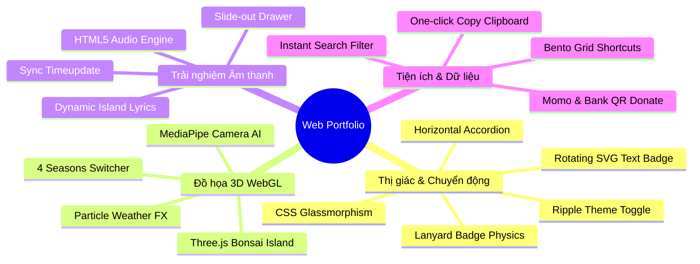
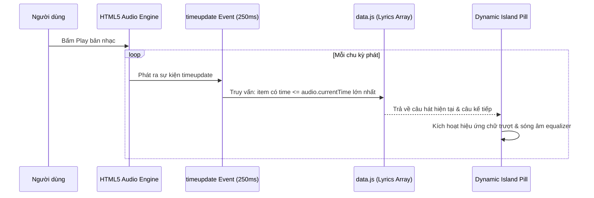

# TÀI LIỆU TOÀN DIỆN: ĐẶC TẢ KIẾN TRÚC & HƯỚNG DẪN TÁI HIỆN WEB PORTFOLIO TƯƠNG TÁC CAO
## ĐỒ ÁN HỌC PHẦN: THIẾT KẾ HỒ SƠ NĂNG LỰC CÔNG NGHỆ & WEB PORTFOLIO TRỰC TUYẾN TRÊN GITHUB PAGES

---

* **Tác giả đồ án:** Hồ Tiến Phát (Lake Fot)
* **Đơn vị đào tạo:** Đại học Công nghệ TP.HCM (HUTECH) — Khoa Công nghệ Thông tin
* **Chuyên ngành:** Công nghệ Thông tin / Kỹ thuật Phần mềm
* **Sản phẩm trực tuyến:** [https://hotienphat.github.io/web/](https://hotienphat.github.io/web/)
* **Kho mã nguồn (GitHub):** [https://github.com/hotienphat/web](https://github.com/hotienphat/web)

---

## LỜI NÓI ĐẦU DÀNH CHO BẠN SINH VIÊN

Chào bạn! Mình hiểu bạn đang vô cùng áp lực và mệt mỏi khi giảng viên giao đồ án học phần với thời hạn chỉ có vài ngày ngắn ngủi. Trong ngành CNTT, việc phải hoàn thiện một sản phẩm vừa có giao diện hiện đại, vừa có tính năng kỹ thuật cao (3D WebGL, Physics, Audio, Responsive), vừa phải có tài liệu báo cáo để thuyết trình bảo vệ là một thử thách lớn.

Tài liệu này được biên soạn dưới dạng **Master Blueprint (Bản thiết kế & Hướng dẫn Tái hiện Độc lập)**. Nó chứa đựng:
1. **Toàn bộ cấu trúc thư mục, quy tắc tài nguyên, đường dẫn** giúp bạn tạo lập dự án mà không bao giờ gặp lỗi đường dẫn 404.
2. **Giải trình bản chất kỹ thuật và giải thuật từng phân hệ (Module)**: Thuật toán con lắc đơn Lanyard Badge, cơ chế Dynamic Island hiển thị lời bài hát đồng bộ từng giây, đồ họa 3D Three.js 4 Mùa biến đổi bằng AI Camera tay, hiệu ứng chuyển màu Dark/Light dạng sóng tròn (Circular Ripple)...
3. **Mã nguồn khung mẫu (Code Boilerplate) và Schema dữ liệu** để bạn sao chép, tùy biến hoặc đưa cho bất kỳ AI nào tiếp tục sinh thêm tính năng.
4. **Quy trình từng bước từ máy cục bộ lên GitHub Pages miễn phí 100% vĩnh viễn**.
5. **Kịch bản trả lời phản biện trước Thầy/Cô** giúp bạn chứng minh quyền tự chủ mã nguồn, tự tin đạt điểm 9-10 dù thời gian làm bài gấp rút.

---

## MỤC LỤC CHI TIẾT

- [1. TỔNG QUAN DỰ ÁN & ĐỊNH HƯỚNG SẢN PHẨM](#1-tổng-quan-dự-án--định-hướng-sản-phẩm)
- [2. CẤU TRÚC THƯ MỤC & DANH MỤC TÀI NGUYÊN (ASSETS)](#2-cấu-trúc-thư-mục--danh-mục-tài-nguyên-assets)
- [3. TECH STACK & BỘ THƯ VIỆN KỸ THUẬT (DEPENDENCY ARCHITECTURE)](#3-tech-stack--bộ-thư-viện-kỹ-thuật-dependency-architecture)
- [4. HỆ THỐNG THIẾT KẾ UI/UX (DESIGN SYSTEM & TOKENS)](#4-hệ-thống-thiết-kế-uiux-design-system--tokens)
- [5. BẢN ĐẶC TẢ CHI TIẾT & GIẢI THUẬT TỪNG PHÂN HỆ (MODULE BLUEPRINTS)](#5-bản-đặc-tả-chi-tiết--giải-thuật-từng-phân-hệ-module-blueprints)
  - [5.1. Module Intro Splash & Shockwave Flash](#51-module-intro-splash--shockwave-flash)
  - [5.2. Module Top Navigation Dock & Dynamic Island Live Lyrics](#52-module-top-navigation-dock--dynamic-island-live-lyrics)
  - [5.3. Module Hero Section & Thẻ Sinh Viên Vật Lý (Lanyard Badge Physics)](#53-module-hero-section--thẻ-sinh-viên-vật-lý-lanyard-badge-physics)
  - [5.4. Module About Section & Vòng Chữ Xoay SVG Bát Giác](#54-module-about-section--vòng-chữ-xoay-svg-bát-giác)
  - [5.5. Module Bento Grid Shortcuts Hub (Mạng Xã Hội, Học Tập & Tiện Ích)](#55-module-bento-grid-shortcuts-hub-mạng-xã-hội-học-tập--tiện-ích)
  - [5.6. Module Work & Projects Showcase (Horizontal Interactive Accordion)](#56-module-work--projects-showcase-horizontal-interactive-accordion)
  - [5.7. Module Không Gian 3D 4 Mùa (Three.js WebGL Bonsai Island & MediaPipe Camera AI)](#57-module-không-gian-3d-4-mùa-threejs-webgl-bonsai-island--mediapipe-camera-ai)
  - [5.8. Module Trình Phát Nhạc Nền (Slide-out Soundtrack Drawer)](#58-module-trình-phát-nhạc-nền-slide-out-soundtrack-drawer)
  - [5.9. Module Đổi Giao Diện Sáng/Tối Sóng Tròn (Circular Ripple Clip-Path)](#59-module-đổi-giao-diện-sángtối-sóng-tròn-circular-ripple-clip-path)
  - [5.10. Module Canvas Hạt Nền (Particle System) & Vệt Chuột (Cursor Trail)](#510-module-canvas-hạt-nền-particle-system--vệt-chuột-cursor-trail)
  - [5.11. Module Ủng Hộ (Donate QR) & Clipboard API](#511-module-ủng-hộ-donate-qr--clipboard-api)
- [6. CẤU TRÚC TỆP DỮ LIỆU ĐẶC TẢ (`data.js`)](#6-cấu-trúc-tệp-dữ-liệu-đặc-tả-datajs)
- [7. HƯỚNG DẪN TÁI HIỆN TỪNG BƯỚC TỪ SỐ 0 (STEP-BY-STEP REPRODUCTION)](#7-hướng-dẫn-tái-hiện-từng-bước-từ-số-0-step-by-step-reproduction)
- [8. BỘ KỊCH BẢN PHẢN BIỆN TRƯỚC GIẢNG VIÊN (DEFENSE CHEATSHEET)](#8-bộ-kịch-bản-phản-biện-trước-giảng-viên-defense-cheatsheet)
- [9. PHỤ LỤC: MỞ RỘNG PHIÊN BẢN REACT (`Portfolio.jsx`)](#9-phụ-lục-mở-rộng-phiên-bản-react-portfoliojsx)

---

## 1. TỔNG QUAN DỰ ÁN & ĐỊNH HƯỚNG SẢN PHẨM

### 1.1. Bản chất Dự án
Đây là một **Web Portfolio Cá Nhân Tương Tác Cao (High-Interactivity Creative Tech Portfolio)** dành cho sinh viên ngành Công nghệ Thông tin. Dự án vượt ra khỏi khuôn mẫu của một trang sơ yếu lý lịch thông thường để trở thành một "Không gian số cá nhân" (Digital Cyber Sanctuary), tích hợp trình phát nhạc nền, hiệu ứng vật lý thời gian thực, không gian 3D biến đổi 4 mùa và khả năng điều khiển cử chỉ tay qua Camera.

### 1.2. Mục tiêu Học phần
1. **Minh chứng kỹ năng chuyên môn:** Làm chủ HTML5 ngữ nghĩa, CSS3 nâng cao (Glassmorphism, CSS Grid, Custom Properties), JavaScript ES6 thuần và thư viện đồ họa máy tính WebGL (Three.js).
2. **Tối ưu trải nghiệm người dùng (UX):** Giữ vững tốc độ 60fps - 144fps trên mọi thiết bị thông qua việc tối ưu vòng lặp render, kiểm soát cờ giảm chuyển động (`prefers-reduced-motion`) và giải phóng tài nguyên khi tab bị ẩn.
3. **Triển khai thực tế:** Vận hành trực tiếp trên GitHub Pages, đáp ứng các tiêu chuẩn khắt khe về đường dẫn tài nguyên tương đối và SEO cơ bản.



---

## 2. CẤU TRÚC THƯ MỤC & DANH MỤC TÀI NGUYÊN (ASSETS)

### 2.1. Cây thư mục hoàn chỉnh
```
web/
├── assets/                          # Thư mục lưu trữ hình ảnh, biểu tượng và âm thanh
│   ├── anhthe.jpg                   # Ảnh thẻ dự phòng (1.6 MB)
│   ├── hinhthe.jpg                  # Ảnh thẻ chính gắn trên thẻ Lanyard (1.6 MB)
│   ├── avt.png                      # Ảnh đại diện cá nhân hình vuông (130 KB)
│   ├── xoaphong.png                 # Ảnh chân dung đã tách nền trong suốt dùng cho Hero (165 KB)
│   ├── hutech.png                   # Biểu trưng trường Đại học HUTECH (113 KB)
│   ├── Momo.png                     # Mã QR thanh toán ví MoMo (35 KB)
│   ├── Viettin.png                  # Mã QR tài khoản ngân hàng VietinBank (53 KB)
│   ├── LVE.jpg                      # Ảnh bìa đĩa đơn bài hát LAVIEM (153 KB)
│   ├── spin.jpg                     # Ảnh bìa đĩa đơn bài hát SPIN (428 KB)
│   ├── Phepmaulogo.jpg              # Ảnh bìa đĩa đơn bài hát Phép Màu (42 KB)
│   ├── CGDH.jpg                     # Ảnh bìa đĩa đơn bài hát Còn Gì Đẹp Hơn (12 KB)
│   ├── Danny Chung - LAVIEM.flac    # Tệp âm thanh FLAC chất lượng cao bài LAVIEM
│   ├── Kroi - SPIN.flac             # Tệp âm thanh FLAC bài SPIN
│   ├── phepmau.mp3                  # Tệp âm thanh bài Phép Màu
│   └── congidephon.mp3              # Tệp âm thanh bài Còn Gì Đẹp Hơn
├── index.html                       # Khung cấu trúc ngữ nghĩa HTML5 & SEO Meta
├── style.css                        # Toàn bộ mã định kiểu CSS, Theme Tokens & Hiệu ứng
├── data.js                          # Cơ sở dữ liệu tĩnh: Lời bài hát theo giây, Playlist, Shortcuts
├── script.js                        # Bộ não ứng dụng: Vật lý thẻ, Âm thanh, Điều hướng, Theme
├── tree.js                          # Phân hệ đồ họa 3D Three.js & Nhận diện cử chỉ Camera MediaPipe
├── Portfolio.jsx                    # Bản chuyển đổi React + Tailwind + Framer Motion (Tham khảo)
├── package.json                     # Cấu hình dự án và kịch bản Tailwind CSS CLI
├── BAO_CAO_DO_AN.md                 # Báo cáo học thuật chi tiết nộp giảng viên
├── PROJECT_REPORT.md                # Tóm tắt kỹ thuật dự án (English)
├── PRODUCT.md                       # Đặc tả định vị sản phẩm và hành vi người dùng
└── DESIGN.md                        # Quy chuẩn hệ thống thiết kế (Design Tokens)
```

### 2.2. Quy tắc Sống còn về Đường dẫn Tài nguyên Tương đối (Relative Paths)
> [!CAUTION]
> Khi lưu trữ web trên GitHub Pages, trang web thường nằm trong thư mục con dạng `https://username.github.io/web/`.
> - **TUYỆT ĐỐI KHÔNG DÙNG:** `/assets/avt.png` (sẽ trỏ nhầm về gốc domain `https://username.github.io/assets/avt.png` -> Lỗi 404 gãy ảnh).
> - **BẮT BUỘC DÙNG:** `./assets/avt.png` hoặc `assets/avt.png` để đảm bảo trình duyệt luôn tìm đúng thư mục cục bộ của dự án.

---

## 3. TECH STACK & BỘ THƯ VIỆN KỸ THUẬT (DEPENDENCY ARCHITECTURE)

Dự án ưu tiên kiến trúc **Zero-Build Runtime** (chạy trực tiếp trên trình duyệt mà không bắt buộc phải qua khâu đóng gói webpack/vite phức tạp). Điều này giúp sinh viên nộp bài dễ dàng, thầy cô mở tệp `index.html` là web hoạt động ngay lập tức.

| Thành phần | Công nghệ / Thư viện | Phiên bản | Mục đích sử dụng | Phương thức nạp |
| :--- | :--- | :--- | :--- | :--- |
| **Cốt lõi (Core)** | HTML5, CSS3, ES6+ JS | Native | Bố cục ngữ nghĩa, biến CSS, logic điều khiển | Trực tiếp trong kho mã |
| **Đồ họa 3D** | Three.js | r128 | Dựng Scene, Camera, Mesh, Ánh sáng, Hệ thống Hạt | CDN (cdnjs) |
| **Điều khiển 3D** | OrbitControls | 0.128.0 | Hỗ trợ người dùng kéo xoay, phóng to thu nhỏ mô hình 3D | CDN (jsdelivr) |
| **Nhận diện Cử chỉ**| MediaPipe Hands | 0.4.16 | Phân tích 21 điểm khớp ngón tay từ webcam để điều khiển 3D | Nạp động qua JS (Dynamic script) |
| **Chuyển động** | GSAP & ScrollTrigger | 3.12.5 | Điều khiển chuyển động cuộn bắt điểm (Snap Scroll) | CDN (cdnjs) |
| **Biểu tượng** | FontAwesome Free | 6.5.1 | Icon mạng xã hội, nút điều khiển âm nhạc, tiện ích | CDN (cdnjs) |
| **Phông chữ** | Google Fonts | - | `Space Grotesk` (Tiêu đề), `Inter` (Nội dung) | WebFont Link |

### Cơ chế nạp thư viện bất đồng bộ (Non-blocking):
Toàn bộ các thẻ `<script>` ở cuối tệp `index.html` đều được gán thuộc tính `defer` để quá trình dựng cây DOM của trình duyệt không bị gián đoạn:
```html
<script src="https://cdnjs.cloudflare.com/ajax/libs/three.js/r128/three.min.js" defer></script>
<script src="https://cdn.jsdelivr.net/npm/three@0.128.0/examples/js/controls/OrbitControls.js" defer></script>
<script src="https://cdnjs.cloudflare.com/ajax/libs/gsap/3.12.5/gsap.min.js" defer></script>
<script src="https://cdnjs.cloudflare.com/ajax/libs/gsap/3.12.5/ScrollTrigger.min.js" defer></script>
<script src="data.js" defer></script>
<script src="tree.js" defer></script>
<script src="script.js" defer></script>
```

---

## 4. HỆ THỐNG THIẾT KẾ UI/UX (DESIGN SYSTEM & TOKENS)

### 4.1. Bảng màu Kép (Dual Theme System)
Hệ thống sử dụng các biến CSS Custom Properties định nghĩa tại `:root` và ghi đè khi phần tử mang lớp `.light-theme`:

```css
:root {
    /* Chế độ Tối (Moss Green Cyber Dark - Mặc định) */
    --bg-primary: #070c08;
    --bg-secondary: #0b140d;
    --bg-surface: rgba(13, 24, 16, 0.65);
    --bg-surface-elevated: rgba(18, 34, 22, 0.85);
    --border-color: rgba(34, 197, 94, 0.15);
    --border-bright: rgba(34, 197, 94, 0.35);
    --accent-green: #22c55e;
    --accent-emerald: #10b981;
    --accent-cyan: #06b6d4;
    --accent-purple: #a855f7;
    --text-primary: #f0fdf4;
    --text-secondary: #86efac;
    --text-muted: #4ade80;
    --card-glow: rgba(34, 197, 94, 0.12);
    --glass-blur: blur(16px);
}

.light-theme {
    /* Chế độ Sáng (Studio Porcelain Light) */
    --bg-primary: #f4f8f5;
    --bg-secondary: #e8f0ea;
    --bg-surface: rgba(255, 255, 255, 0.75);
    --bg-surface-elevated: rgba(255, 255, 255, 0.92);
    --border-color: rgba(16, 185, 129, 0.2);
    --border-bright: rgba(16, 185, 129, 0.45);
    --text-primary: #0f2416;
    --text-secondary: #166534;
    --text-muted: #15803d;
    --card-glow: rgba(16, 185, 129, 0.15);
}
```

### 4.2. Công thức Glassmorphism Tiêu Chuẩn
Tất cả các thẻ (Bento, Player, Modal, Accordion) đều tuân theo công thức:
1. Nền bán trong suốt: `background: var(--bg-surface);`
2. Làm mờ hậu cảnh: `backdrop-filter: var(--glass-blur); -webkit-backdrop-filter: var(--glass-blur);`
3. Viền mờ phản chiếu: `border: 1px solid var(--border-color);`
4. Bóng đổ màu dịu: `box-shadow: 0 8px 32px 0 rgba(0, 0, 0, 0.37);`

---

## 5. BẢN ĐẶC TẢ CHI TIẾT & GIẢI THUẬT TỪNG PHÂN HỆ (MODULE BLUEPRINTS)

### 5.1. Module Intro Splash & Shockwave Flash
* **Mục đích:** Tạo ấn tượng khởi động công nghệ (Boot sequence) khi người xem vừa tải trang, ngăn hiện tượng giật màn hình trong lúc các tài nguyên lớn đang tải.
* **Cơ chế vận hành:**
  1. Thẻ `#intro-overlay` che phủ toàn màn hình (`z-index: 99999`).
  2. Một đốm sáng trắng bung tỏa (`.intro-flash`), đồng thời pop-up chân dung nhân vật bay lên kèm hiệu ứng viền sáng đa sắc (`.intro-avatar-ring`).
  3. Dòng chữ `LAKE FOT - INITIALIZING EXPERIENCE...` hiển thị trong 1.2s.
  4. Lớp sóng xung kích (`.intro-shockwave`) mở rộng, sau đó toàn bộ overlay mờ dần (`opacity: 0`) rồi tự gỡ khỏi DOM bằng thuộc tính `display: none` để người dùng bắt đầu tương tác với trang chính.

---

### 5.2. Module Top Navigation Dock & Dynamic Island Live Lyrics
* **Cấu trúc:** Nằm cố định ở đỉnh màn hình (`top-nav-dock`), gồm thanh Menu điều hướng dạng kính nổi (`floating-header`) và viên thuốc động hiển thị lời bài hát (`navLyricsPill`).
* **Thuật toán Đồng bộ Lời bài hát theo thời gian thực (Dynamic Island Sync):**
  - Trong `script.js`, sự kiện `timeupdate` của đối tượng `Audio` được lắng nghe liên tục:
    ```javascript
    audio.addEventListener('timeupdate', () => {
        const currentTime = audio.currentTime;
        updateDynamicLyrics(currentTime);
    });
    ```
  - Mảng lời bài hát trong `data.js` được sắp xếp theo mốc thời gian tăng dần `[ { time: 0, text: "..." }, { time: 13.99, text: "..." } ]`.
  - Hàm `updateDynamicLyrics` dùng thuật toán duyệt ngược hoặc nhị phân để tìm câu hát có `lyric.time <= currentTime`.
  - Nếu câu hát hiện tại khác với câu trước đó (`currentIndex !== lastIndex`), kích hoạt hiệu ứng trượt chữ: dòng cũ mờ dần bay lên trên, dòng mới trượt từ dưới lên kèm hiệu ứng gợn sóng nhạc (`.lyrics-pill-wave`).



---

### 5.3. Module Hero Section & Thẻ Sinh Viên Vật Lý (Lanyard Badge Physics)
Đây là module tạo ấn tượng thị giác mạnh nhất trang web, kết hợp 3 lớp chiều sâu đồ họa:
1. **Lớp sâu nhất:** Dòng chữ chữ hoa chạy ngang vô tận (`.hero-marquee-track`) tạo cảm giác không gian mạng sống động.
2. **Lớp giữa:** Ảnh chân dung tách nền trong suốt (`#heroCutoutImg`), đặt sát chân trang web.
3. **Lớp nổi trên cùng:** Thẻ định danh sinh viên (Lanyard Badge) treo từ đỉnh màn hình bằng dây đeo có thể tương tác vật lý.

#### Thuật toán Mô phỏng Con Lắc Đơn Lò Xo (Pendulum Spring Physics)
Thẻ nhân viên được treo tại một điểm chốt cố định `(anchorX, anchorY)`. Vị trí của thẻ được tính toán qua phương trình vi phân dao động con lắc:

$$\alpha = -\frac{g}{L} \cdot \sin(\theta) - c \cdot \omega$$

Trong đó:
* $\theta$: Góc lệch hiện tại của thẻ so với phương thẳng đứng.
* $\omega$: Vận tốc góc (`angularVelocity`).
* $\alpha$: Gia tốc góc (`angularAcceleration`).
* $g$: Trọng lực mô phỏng (`gravity = 0.4`).
* $L$: Chiều dài dây treo (`length = 180px`).
* $c$: Hệ số cản không khí (`damping = 0.94` giúp dao động tắt dần êm ái).

```javascript
// Trích xuất mã thuật toán cốt lõi trong script.js (initLanyardBadge)
function updatePhysics() {
    if (!isDragging) {
        // Tính gia tốc phục hồi dựa trên góc lệch
        const force = -gravity * Math.sin(angle);
        angularVelocity += force;
        angularVelocity *= damping; // Suy giảm vận tốc dần theo thời gian
        angle += angularVelocity;
    }
    // Cập nhật ma trận biến đổi CSS 2D/3D
    const cardX = anchorX + length * Math.sin(angle);
    const cardY = anchorY + length * Math.cos(angle);
    lanyardCard.style.transform = `translate(${cardX}px, ${cardY}px) rotate(${angle * (180 / Math.PI)}deg)`;
    requestAnimationFrame(updatePhysics);
}
```

#### Tích hợp Cảm biến Con quay hồi chuyển (Mobile Device Orientation)
Khi người dùng duyệt web trên điện thoại thật, hệ thống bắt sự kiện nghiêng máy:
```javascript
window.addEventListener('deviceorientation', (e) => {
    if (e.gamma !== null) {
        // e.gamma là góc nghiêng trái/phải (-90 đến +90 độ)
        const targetAngle = (e.gamma * Math.PI) / 180;
        angularVelocity += (targetAngle - angle) * 0.05;
    }
});
```

---

### 5.4. Module About Section & Vòng Chữ Xoay SVG Bát Giác
* **Avatar Bát Giác:** Ảnh chân dung được cắt viền vát 8 cạnh bằng CSS Clip-path:
  ```css
  clip-path: polygon(30% 0%, 70% 0%, 100% 30%, 100% 70%, 70% 100%, 30% 100%, 0% 70%, 0% 30%);
  ```
* **Vòng chữ xoay 360 độ liên tục:** Sử dụng thẻ SVG `<textPath>` bám theo quỹ đạo đường tròn khép kín, áp dụng animation xoay vô tận:
  ```html
  <svg viewBox="0 0 380 380" class="rotating-text-svg">
      <defs>
          <path id="avatarCirclePath" d="M 190, 190 m -155, 0 a 155,155 0 1,1 310,0 a 155,155 0 1,1 -310,0" />
      </defs>
      <text class="avatar-curved-text">
          <textPath href="#avatarCirclePath">
              • LAKE FOT • HO TIEN PHAT • DEVELOPER • HUTECH •
          </textPath>
      </text>
  </svg>
  ```
* **Thanh Marquee Kỹ năng (Tech Stack Bar):** Chạy liên tục các biểu tượng React, Three.js, Node.js, Python, Tailwind với hiệu ứng gương phản chiếu.

---

### 5.5. Module Bento Grid Shortcuts Hub (Mạng Xã Hội, Học Tập & Tiện Ích)
Lấy cảm hứng từ phong cách bố cục **Bento Box của Apple**, chia thông tin thành 4 khối chức năng:
1. **Mạng xã hội:** Liên kết Facebook, Messenger, Instagram, Threads.
2. **Góc học tập & Công cụ cá nhân:**
   - *Kỷ luật online:* Ứng dụng nề nếp thi đua học đường (`kyluatonline.vercel.app`).
   - *Tạo khung:* Web app xử lý Canvas tạo khung avatar chiến dịch (`hotienphat.github.io/frame/`).
   - *Hệ thống trực nề nếp:* Nền tảng điều phối giám thị thi trực tuyến PWA (`giamthi.vercel.app`).
   - *Trung tâm GDTX Đắk Nông.*
3. **Giải trí & Chill:** Phím tắt đến Genshin Impact, Valorant, Honkai Star Rail, Spotify.
4. **Google & Tiện ích:** YouTube, Gmail, Google Drive.

Mỗi thẻ Bento có hiệu ứng **Radial Glow Border**: khi con trỏ chuột di chuyển trên mặt thẻ, vị trí `(x, y)` được tính toán để tạo quầng sáng đi theo chuột (`background: radial-gradient(circle at var(--mouse-x) var(--mouse-y), ...)`).

---

### 5.6. Module Work & Projects Showcase (Horizontal Interactive Accordion)
* **Ý tưởng thiết kế:** Thay vì danh sách cuộn dọc đơn điệu, 4 dự án tiêu biểu được dàn hàng ngang thành dạng "Đàn xếp tương tác" (Accordion).
* **Cơ chế hoạt động:**
  - Mặc định hoặc khi hover vào một thẻ dự án, thẻ đó sẽ mở rộng với tỷ lệ `flex: 3.5`.
  - Các thẻ còn lại co về tỷ lệ `flex: 1`. Tiêu đề của thẻ co lại sẽ tự động xoay dọc 90 độ (`writing-mode: vertical-rl; transform: rotate(180deg);`).
  - Thẻ mở rộng hiển thị đầy đủ: Ảnh chụp màn hình, mô tả giải pháp công nghệ, tags nhãn (Three.js, WebGL, Next.js, Canvas API), nút xem Demo trực tiếp và nút mở GitHub Repository.

```
+----------------+----------------+--------------------------------------+----------------+
| 01             | 02             | 03                                   | 04             |
| 3D SEASONS     | KỶ LUẬT ONLINE | TẠO KHUNG AVATAR                     | TRỰC NỀ NẾP    |
| (Co lại flex:1)| (Co lại flex:1)| (Đang kích hoạt mở rộng flex: 3.5)   | (Co lại flex:1)|
|                |                | - Web app căn chỉnh ảnh & Canvas API |                |
|                |                | - Tags: HTML5, Canvas, Responsive    |                |
|                |                | - [Nút Xem Demo] [Nút GitHub]        |                |
+----------------+----------------+--------------------------------------+----------------+
```

---

### 5.7. Module Không Gian 3D 4 Mùa (Three.js WebGL Bonsai Island & MediaPipe Camera AI)
Đây là phân hệ kỹ thuật phức tạp nhất, được đóng gói hoàn toàn trong tệp `tree.js`:

#### 1. Khởi tạo Khung cảnh 3D (Scene & Lighting)
* Tạo `THREE.Scene()` kèm hiệu ứng sương mù ma mị (`THREE.FogExp2(0x0a0a16, 0.016)`).
* Ánh sáng gồm:
  - `AmbientLight` dịu nhẹ cho vùng khuất.
  - `DirectionalLight` mô phỏng ánh nắng mặt trời có đổ bóng mềm (`castShadow = true`).
  - `PointLight` màu ngọc bích đặt tại hòn đảo tạo điểm nhấn phát quang viễn tưởng.

#### 2. Dựng Hình học Thủ công (Procedural Generation)
* **Đảo bay (Floating Island Base):** Sử dụng `CylinderGeometry` kết hợp thuật toán làm méo đỉnh (Vertex Displacement) để tạo bề mặt đá gồ ghề tự nhiên.
* **Thân cây Bonsai:** Dựng từ đường cong không gian 3 chiều `CatmullRomCurve3`, sau đó đùn thành ống gỗ mềm uốn lượn u tịch phong cách Á Đông (`TubeGeometry`).
* **Tán lá cây (Foliage):** Kết hợp nhiều khối đa diện `IcosahedronGeometry` đan xen vào nhau tạo thành từng chùm lá phân tầng low-poly nghệ thuật.

#### 3. Hệ thống Hạt & Biến đổi 4 Mùa (Dynamic 4-Season Weather)
Khi người dùng bấm vào các nút hoặc ra hiệu lệnh tay, hàm `switchSeason(seasonName)` được kích hoạt:

| Mùa | Màu sắc tán lá | Hiệu ứng hạt thời tiết | Ánh sáng & Bầu không khí |
| :--- | :--- | :--- | :--- |
| **Xuân (Spring)** | Hồng hoa anh đào (`#f472b6`) | Hạt phấn hoa & cánh anh đào rơi chầm chậm | Ánh sáng ban mai ửng hồng ấm áp |
| **Hạ (Summer)** | Xanh lục bảo nhiệt đới (`#10b981`)| Hạt ánh nắng vàng bốc lên từ mặt đất | Ánh sáng rực rỡ, độ tương phản cao |
| **Thu (Autumn)** | Cam đỏ lá phong (`#f97316`) | Lá vàng phong rơi xoay lảo đảo theo gió | Ánh chiều tà lãng mạn, ấm cúng |
| **Đông (Winter)** | Trắng phủ tuyết băng (`#e0f2fe`) | Bão tuyết rơi dày đặc, gió cuốn ngang | Ánh sáng lạnh buốt, sương mù dày |

#### 4. Nhận diện Cử chỉ Tay qua Camera AI (MediaPipe Hands Integration)
* **Không cần tải nặng lúc đầu:** Thư viện MediaPipe Hands chỉ được tải khi người dùng chủ động bấm nút "Camera AI".
* **Bảo mật tuyệt đối:** Dữ liệu video từ webcam được xử lý 100% bằng WebAssembly/GPU ngay trên máy người dùng, không truyền bất kỳ hình ảnh nào về máy chủ.
* **Bảng điều khiển cử chỉ:**
  - 🖐️ **Xoay mô hình:** Di chuyển lòng bàn tay sang trái / phải / lên / xuống để xoay camera 3D quanh cây.
  - 🔍 **Thu phóng (Zoom):** Đưa bàn tay lại gần camera để Zoom In; đưa ra xa để Zoom Out (tính theo khoảng cách giữa cổ tay và ngón giữa: `handSpan = Math.hypot(x9 - x0, y9 - y0)`).
  - 🌸 **Đổi mùa bằng số ngón tay:** Giơ 1 ngón tay = Mùa Xuân, 2 ngón = Mùa Hạ, 3 ngón = Mùa Thu, 4 ngón = Mùa Đông!

---

### 5.8. Module Trình Phát Nhạc Nền (Slide-out Soundtrack Drawer)
* **Thanh Dock Nhạc nổi (`#playerDockBtn`):** Nằm cố định ở góc dưới màn hình, tích hợp cột sóng âm equalizer nhảy múa theo nhịp nhạc khi đang phát.
* **Ngăn kéo điều khiển (`#playerPanel`):** Khi bấm vào nút dock, ngăn kéo trượt ra từ góc màn hình với hiệu ứng kính mờ gồm:
  - Đĩa than / Ảnh bìa album xoay tròn 360 độ (`fa-spin-pulse`).
  - Thanh tua nhạc (Progress Bar) hiển thị thời gian hiện tại / tổng thời gian.
  - Cụm nút: Bài trước, Phát/Tạm dừng, Dừng, Bài kế tiếp, Bật/Tắt Dynamic Island lyrics, Thanh trượt âm lượng.
  - Danh sách bài hát (Tracklist) có thể chọn phát ngay lập tức.

---

### 5.9. Module Đổi Giao Diện Sáng/Tối Sóng Tròn (Circular Ripple Clip-Path)
* **Ý tưởng:** Tránh việc trang web đổi màu giật cục đột ngột. Thay vào đó, một làn sóng tròn đổi màu sẽ lan tỏa từ chính vị trí con trỏ chuột của người dùng ra toàn bộ màn hình.
* **Thuật toán tính bán kính bao phủ:**
  ```javascript
  function toggleTheme(event) {
      const x = event.clientX;
      const y = event.clientY;
      // Tính khoảng cách từ con trỏ chuột đến góc xa nhất của màn hình
      const endRadius = Math.hypot(
          Math.max(x, window.innerWidth - x),
          Math.max(y, window.innerHeight - y)
      );

      // Nếu trình duyệt hỗ trợ Document View Transition API
      if (document.startViewTransition) {
          const transition = document.startViewTransition(() => {
              document.documentElement.classList.toggle('light-theme');
          });
          transition.ready.then(() => {
              document.documentElement.animate({
                  clipPath: [
                      `circle(0px at ${x}px ${y}px)`,
                      `circle(${endRadius}px at ${x}px ${y}px)`
                  ]
              }, {
                  duration: 500,
                  easing: 'ease-in-out',
                  pseudoElement: '::view-transition-new(root)'
              });
          });
      } else {
          // Fallback cho trình duyệt cũ
          document.documentElement.classList.toggle('light-theme');
      }
  }
  ```

---

### 5.10. Module Canvas Hạt Nền (Particle System) & Vệt Chuột (Cursor Trail)
* **Lưới hạt mạng nhện (`ParticleSystem`):** Khởi tạo 60 - 80 hạt di chuyển tự do. Khi khoảng cách giữa 2 hạt nhỏ hơn 120px, vẽ một đường kẻ nối mờ ảo giữa chúng. Khi chuột di chuyển đến gần, các hạt sẽ bị đẩy lùi (Mouse Repulsion).
* **Vệt sáng con trỏ (`CursorTrail`):** Lưu trữ 12 tọa độ gần nhất của con trỏ chuột, vẽ các đốm sáng nhỏ dần và mờ dần tạo hiệu ứng vệt sao băng chuyển động theo tay người dùng.
* **Bảo vệ tài nguyên & Tiết kiệm Pin:**
  ```javascript
  document.addEventListener('visibilitychange', () => {
      if (document.hidden) {
          cancelAnimationFrame(animationFrameId); // Dừng render khi chuyển tab
      } else {
          requestAnimationFrame(renderLoop); // Chạy lại khi quay lại tab
      }
  });
  ```

---

### 5.11. Module Ủng Hộ (Donate QR) & Clipboard API
* Khối thẻ MoMo và VietinBank thiết kế với nút bật/mở QR code dạng trượt gập mượt mà.
* Nút sao chép số tài khoản sử dụng chuẩn Web API hiện đại `navigator.clipboard.writeText(...)`.
* Khi bấm sao chép, một hộp thông báo nổi Toast nhỏ ("✓ Đã sao chép vào bộ nhớ tạm!") sẽ hiện lên trong 2 giây rồi tự ẩn.

---

## 6. CẤU TRÚC TỆP DỮ LIỆU ĐẶC TẢ (`data.js`)

Để tái hiện website hoặc thay đổi thông tin thành của bạn, chỉ cần chỉnh sửa nội dung trong tệp `data.js` mà không cần đụng vào logic hiển thị của `script.js`:

```javascript
// 1. Cấu hình danh mục liên kết Bento
const shortcutSections = [
    {
        title: "MẠNG XÃ HỘI",
        iconPrefix: "fab",
        shortcuts: [
            { name: "Facebook", url: "https://facebook.com/...", icon: "facebook" },
            { name: "Messenger", url: "https://messenger.com", icon: "facebook-messenger" },
            { name: "Instagram", url: "https://instagram.com/...", icon: "instagram" },
            { name: "Threads", url: "https://threads.net/...", icon: "threads" }
        ]
    },
    {
        title: "GÓC HỌC TẬP",
        iconPrefix: "fas",
        shortcuts: [
            { name: "Kỷ luật online", url: "https://kyluatonline.vercel.app", icon: "shield-alt" },
            { name: "Tạo khung", url: "https://hotienphat.github.io/frame/", icon: "image" }
        ]
    }
];

// 2. Cấu hình danh sách phát nhạc
const playlistData = [
    {
        title: "LAVIEM.",
        artist: "Quang Hùng MasterD, Captain Boy, Pháp Kiều, Danny Chung",
        src: "./assets/Danny Chung - LAVIEM.flac",
        cover: "./assets/LVE.jpg",
        lyrics: laviemLyrics // Trỏ tới mảng lời bài hát bên dưới
    },
    {
        title: "SPIN",
        artist: "Kroi",
        src: "./assets/Kroi - SPIN.flac",
        cover: "./assets/spin.jpg",
        lyrics: spinLyrics
    }
];

// 3. Cấu hình Lời bài hát theo từng giây (Timestamped Lyrics)
const laviemLyrics = [
    { time: 0, text: "Bài hát: LAVIEM - Say Hi" },
    { time: 13.99, text: "Trái tim anh chẳng còn cần thiết nữa," },
    { time: 16.00, text: "nói chi đến đây cũng thừa..." },
    { time: 17.86, text: "Rượu vang pha với cơn mưa..." }
];
```

---

## 7. HƯỚNG DẪN TÁI HIỆN TỪNG BƯỚC TỪ SỐ 0 (STEP-BY-STEP REPRODUCTION)

Nếu bạn cần tạo lại một trang web tương tự từ đầu trên máy tính cá nhân, hãy làm chính xác theo 8 bước sau:

### Bước 1: Khởi tạo Thư mục Dự án
Mở PowerShell hoặc Terminal và chạy:
```bash
mkdir my-portfolio
cd my-portfolio
mkdir assets
```

### Bước 2: Chuẩn bị Tài nguyên Hình ảnh & Âm thanh
Đặt các tệp tài nguyên vào thư mục `assets/`:
1. `xoaphong.png`: Ảnh chân dung bạn đã tách nền (dùng công cụ miễn phí như remove.bg hoặc Photoshop).
2. `hinhthe.jpg`: Ảnh thẻ làm thẻ đeo cổ Lanyard.
3. `avt.png`: Ảnh đại diện vuông làm avatar xoay.
4. `Momo.png` & `Viettin.png`: Ảnh chụp mã QR chuyển khoản của bạn.
5. Tải 1 hoặc 2 bài nhạc định dạng `.mp3` hoặc `.flac` và ảnh bìa bài hát.

### Bước 3: Tạo Tệp Bố cục HTML (`index.html`)
Tạo tệp `index.html`, sao chép cấu trúc ngữ nghĩa với các phân đoạn:
- Header cố định kèm Search & Theme Toggle & Dynamic Island Pill.
- `#hero-section` chứa Marquee text, Cutout Image và Lanyard Card.
- `#about-section` chứa Vòng xoay SVG và Thẻ thông tin HUTECH.
- `#shortcuts-section` chứa Bento Grid.
- `#projects-section` chứa Horizontal Accordion.
- `#tree-3d-section` chứa container Three.js Canvas.
- `#donate-section` chứa MoMo/Ngân hàng.
- Nạp các thư viện qua CDN (Three.js, GSAP, FontAwesome).

### Bước 4: Tạo Tệp Định kiểu Giao diện (`style.css`)
Thiết lập toàn bộ biến màu CSS `:root` và `.light-theme`, cấu hình hiệu ứng kính mờ (`backdrop-filter`), bố cục `display: flex`, `display: grid` và các keyframes chuyển động.

### Bước 5: Tạo Tệp Cấu hình Dữ liệu (`data.js`)
Điền các đường link mạng xã hội, dự án và danh sách bài hát cùng lời bài hát có gắn mốc thời gian.

### Bước 6: Tạo Tệp Đồ họa 3D (`tree.js`)
Khởi tạo Three.js Scene, Camera, Renderer, dựng cây Bonsai và cấu hình chức năng chuyển 4 mùa.

### Bước 7: Tạo Tệp Điều khiển Ứng dụng (`script.js`)
Lập trình thuật toán con lắc đơn cho thẻ Lanyard, trình phát nhạc Audio API, đồng bộ Dynamic Island và chuyển đổi giao diện sáng tối.

### Bước 8: Kiểm thử Cục bộ (Local Test)
Cài đặt extension **Live Server** trong Visual Studio Code, bấm chuột phải vào `index.html` > chọn **Open with Live Server**. Hoặc mở terminal chạy:
```bash
# Nếu máy đã cài Python:
python -m http.server 8000
```
Mở trình duyệt truy cập: `http://localhost:8000`.

### Bước 9: Triển khai Lên GitHub Pages (Miễn Phí)
```bash
git init
git add .
git commit -m "feat: complete interactive tech portfolio"
git branch -M main
git remote add origin https://github.com/<tên-tài-khoản-của-bạn>/<tên-repo>.git
git push -u origin main
```
Truy cập GitHub > Vào **Settings** của repository > Chọn tab **Pages** > Tại mục **Branch** chọn `main` / `root` > Bấm **Save**. Trang web của bạn sẽ online sau 1 phút!

---

## 8. BỘ KỊCH BẢN PHẢN BIỆN TRƯỚC GIẢNG VIÊN (DEFENSE CHEATSHEET)

Khi làm đồ án trong thời gian gấp rút, giảng viên rất hay đặt các câu hỏi kiểm tra xem bạn có thực sự hiểu code hay chỉ đi copy/nhờ AI làm hộ. Dưới đây là 5 câu hỏi trọng tâm và câu trả lời chuẩn xác nhất:

### Câu hỏi 1:
> **Giảng viên:** *"Tại sao em lại chọn mô phỏng vật lý con lắc đơn cho chiếc thẻ sinh viên ở Hero Section thay vì dùng hiệu ứng CSS animation xoay thông thường?"*

* **Cách trả lời ăn điểm:**
  > *"Thưa Thầy/Cô, nếu dùng CSS keyframe thông thường, chuyển động chỉ là một vòng lặp tuyến tính lặp đi lặp lại vô hồn, không có tính chân thực. Em áp dụng mô hình phương trình vi phân dao động tắt dần của con lắc đơn trong JavaScript: mỗi khung hình tính toán lại góc lệch và vận tốc góc dựa trên gia tốc trọng trường và hệ số cản không khí `damping = 0.94`. Điều này cho phép thẻ phản hồi lại tương tác ngoại lực của người dùng: khi người dùng dùng chuột kéo căng thẻ ra xa rồi thả tay, thẻ sẽ tự đung đưa qua lại và dừng lại hoàn toàn tự nhiên. Ngoài ra, em còn kết nối với sự kiện `deviceorientation` để khi nghiêng điện thoại thật, con lắc ảo cũng nghiêng theo góc nghiêng của thiết bị."*

---

### Câu hỏi 2:
> **Giảng viên:** *"Website của em tích hợp cả Three.js 3D, canvas hạt và trình phát nhạc. Làm thế nào em đảm bảo trang web không bị quá tải CPU/GPU trên máy yếu hoặc điện thoại?"*

* **Cách trả lời ăn điểm:**
  > *"Thưa Thầy/Cô, em đã áp dụng 3 kỹ thuật tối ưu tài nguyên nghiêm ngặt:
  > 1. **Kiểm soát vòng lặp Render:** Em bắt sự kiện `document.visibilitychange`. Khi người dùng chuyển sang tab khác, toàn bộ vòng lặp `requestAnimationFrame` của cả Three.js lẫn Canvas 2D đều lập tức ngắt để không lãng phí chu kỳ xử lý của máy.
  > 2. **Tối ưu phần cứng di động:** Trên màn hình di động (chiều rộng <= 768px), em tự động hạ chỉ số `pixelRatio` từ 1.75 xuống 1.25, đổi thuật toán đổ bóng từ `PCFSoftShadowMap` sang `BasicShadowMap`, và ẩn canvas hạt để dành toàn bộ năng lực GPU cho mô hình 3D.
  > 3. **Tận dụng GPU Composite:** Toàn bộ hiệu ứng mở rộng của dải đàn xếp Accordion và di chuyển thẻ đều dùng thuộc tính `transform: translate3d` và `opacity` để trình duyệt kích hoạt tầng đồ họa phần cứng riêng (Hardware Acceleration), hoàn toàn không gây Reflow bố cục DOM."*

---

### Câu hỏi 3:
> **Giảng viên:** *"Cơ chế Dynamic Island trên thanh Dock nhận biết bài hát và hiển thị đúng lời bài hát theo từng giây hoạt động như thế nào?"*

* **Cách trả lời ăn điểm:**
  > *"Thưa Thầy/Cô, trong tệp `data.js`, em xây dựng mảng lời bài hát với cấu trúc mốc thời gian `{ time: giây, text: 'câu hát' }`. Trong `script.js`, em lắng nghe sự kiện `timeupdate` của đối tượng HTML5 `Audio`. Cứ mỗi chu kỳ phát (khoảng 250ms), hàm `updateDynamicLyrics` lấy giá trị `audio.currentTime` để đối chiếu với mảng. Bằng việc so sánh chỉ số `currentIndex` của câu hát hiện tại, khi câu hát chuyển sang câu mới, em dùng hàm thao tác DOM để cập nhật nội dung văn bản kèm kích hoạt hiệu ứng trượt chữ CSS mượt mà."*

---

### Câu hỏi 4:
> **Giảng viên:** *"Tại sao em sử dụng ảnh chân dung tách nền kết hợp với Marquee text ở Hero Section?"*

* **Cách trả lời ăn điểm:**
  > *"Thưa Thầy/Cô, đây là kỹ thuật xếp lớp đồ họa chiều sâu (Parallax Stacking). Em tách đối tượng người (`xoaphong.png`) thành lớp trong suốt kẹp giữa lớp chữ chuyển động vô tận phía sau và thẻ nhân viên phía trước. Kỹ thuật này tạo cảm giác không gian ba chiều (Depth Perception) đánh lừa thị giác mà không cần dùng đến kính 3D, giúp trang portfolio của em thể hiện được tư duy mỹ thuật hiện đại và cá tính sáng tạo của một kỹ sư Frontend."*

---

### Câu hỏi 5:
> **Giảng viên:** *"Nếu em muốn mở rộng trang web này để nộp bài đồ án theo chuẩn React Component thì có khả thi không?"*

* **Cách trả lời ăn điểm:**
  > *"Dạ hoàn toàn khả thi ạ. Toàn bộ logic giao diện, cấu trúc state và animation đã được em chuẩn hóa trong tệp `Portfolio.jsx` bằng React kết hợp Tailwind CSS và thư viện `framer-motion`. Em hoàn toàn có thể di chuyển toàn bộ logic từ JavaScript thuần sang các hook tiêu chuẩn như `useState`, `useEffect`, `useRef` trong React bất kỳ lúc nào Thầy/Cô yêu cầu ạ."*

---

## 9. PHỤ LỤC: MỞ RỘNG PHIÊN BẢN REACT (`Portfolio.jsx`)

Nếu trong yêu cầu môn học, giảng viên bắt buộc phải nộp sản phẩm bằng **ReactJS**, bạn có sẵn tệp `Portfolio.jsx` trong thư mục gốc. Đây là phiên bản tái cấu trúc toàn bộ giao diện thành React Component với Tailwind CSS:

```jsx
import React, { useState, useEffect, useRef } from 'react';
import { Play, Pause, SkipForward, SkipBack, Sun, Moon, Volume2, Copy } from 'lucide-react';

export default function Portfolio() {
  const [theme, setTheme] = useState('dark');
  const [isPlaying, setIsPlaying] = useState(false);
  const [currentTrackIndex, setCurrentTrackIndex] = useState(0);

  const toggleTheme = () => {
    const nextTheme = theme === 'dark' ? 'light' : 'dark';
    setTheme(nextTheme);
    document.documentElement.classList.toggle('light-theme', nextTheme === 'light');
  };

  return (
    <div className={`min-h-screen ${theme === 'dark' ? 'bg-[#070c08] text-white' : 'bg-[#f4f8f5] text-slate-900'} transition-colors duration-500`}>
      {/* Top Dock Navigation */}
      <header className="fixed top-4 left-1/2 -translate-x-1/2 z-50 px-6 py-3 rounded-full bg-black/40 backdrop-blur-md border border-white/10 flex items-center gap-6">
        <span className="font-bold tracking-wider text-green-400">LAKE FOT</span>
        <nav className="hidden md:flex gap-4 text-sm font-medium">
          <a href="#hero" className="hover:text-green-400 transition">HOME</a>
          <a href="#about" className="hover:text-green-400 transition">ABOUT</a>
          <a href="#projects" className="hover:text-green-400 transition">WORK</a>
        </nav>
        <button onClick={toggleTheme} className="p-2 rounded-full hover:bg-white/10 transition">
          {theme === 'dark' ? <Sun size={18} /> : <Moon size={18} />}
        </button>
      </header>

      {/* Nội dung chi tiết các Section... */}
    </div>
  );
}
```

---

## LỜI KẾT & CHÚC BẠN BẢO VỆ ĐỒ ÁN ĐẠT ĐIỂM XUẤT SẮC!

Dự án này là kết tinh của sự nỗ lực, tư duy thẩm mỹ cao và kiến thức lập trình vững chắc. Dù thời hạn thầy giao có gấp gáp đến đâu, bạn hãy tự tin:
1. Đọc kỹ bản tài liệu này để nắm vững từng giải thuật và câu trả lời phản biện.
2. Mở sẵn Live Demo `https://hotienphat.github.io/web/` trên máy chiếu trước khi lên thuyết trình.
3. Tự tin trình diễn các tính năng độc đáo: kéo lắc thẻ sinh viên, bật nhạc cho Dynamic Island trượt lời bài hát, và xoay cây 3D chuyển mùa.

Chúc bạn giữ gìn sức khỏe, hoàn thành xuất sắc đồ án học phần và nhận điểm 10 xứng đáng từ Hội đồng Giảng viên! 🚀
